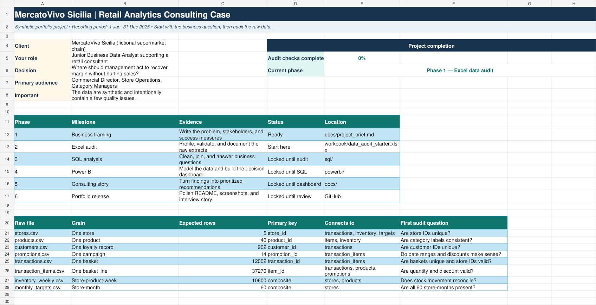

# MercatoVivo Sicilia — Retail Analytics Consulting Case

An end-to-end Business Data Analyst portfolio project about a fictional supermarket chain operating in Sicily.

**Current status:** Phase 1 — Excel data audit  
**Reporting period:** 1 January–31 December 2025  
**Data:** Synthetic, reproducible, and intentionally imperfect  
**Tools:** Excel/Power Query → SQL → Power BI → GitHub

> Business question: Where should MercatoVivo act first to recover gross margin without damaging sales or product availability?

## Why this project exists

Recent Italian analyst vacancies repeatedly ask candidates to combine business judgment with Excel, SQL, Power BI, KPI reporting, variance analysis, dashboarding, and data-quality control. Retail and consumer-goods roles also emphasize store/product profitability, sales trends, pricing, promotions, category performance, and actionable recommendations.

This project turns those requirements into one original consulting case. It follows a professional workflow without copying another creator's dataset, dashboard, or conclusions.

See [Italian market alignment](docs/market_alignment.md) for the job-posting evidence used to design the case.

## The client situation

MercatoVivo's management sees healthy sales in parts of the chain, but it is concerned about:

- uneven store and category performance;
- pressure on gross margin;
- promotion effectiveness;
- waste in perishable categories;
- stockouts and missed monthly targets.

As the analyst, you will turn eight raw extracts into a management dashboard and a short recommendation memo.

## What the finished portfolio will prove

- Business framing and stakeholder thinking
- Excel and Power Query data auditing
- SQL cleaning, joins, CTEs, window functions, and KPI queries
- Power BI star-schema modelling and DAX
- Clear data visualization and executive storytelling
- Commercial recommendations supported by evidence
- Reproducible work and honest AI-use disclosure

## Dataset

The generated analytical sample contains:

| File | Grain | Rows |
|---|---|---:|
| `stores.csv` | Store | 5 |
| `products.csv` | Product | 40 |
| `customers.csv` | Loyalty customer record | 902 |
| `promotions.csv` | Promotion | 14 |
| `transactions.csv` | Basket | 12,002 |
| `transaction_items.csv` | Basket line | 37,270 |
| `inventory_weekly.csv` | Store × product × week | 10,600 |
| `monthly_targets.csv` | Store × month | 60 |

The data are fictional and contain no real customers. The transactions are a teaching sample, not the chain's complete POS volume, so absolute revenue should be described as “revenue in the supplied extract.” A small number of quality defects are intentional. Valid business conditions—such as anonymous purchases and returns—must not be mistaken for errors.

## Start here

1. Read [the consulting brief](docs/project_brief.md).
2. Open [`workbook/data_audit_starter.xlsx`](workbook/data_audit_starter.xlsx).
3. Read the `START_HERE`, `KPI_DEFINITIONS`, and `DATA_DICTIONARY` tabs (or the [Markdown dictionary](docs/data_dictionary.md)).
4. Complete [Assignment 1](docs/assignment_01_excel_audit.md).
5. Record results in the workbook's `AUDIT_LOG`; do not clean or delete rows yet.

The learning sequence and review gates are in [the A–Z roadmap](docs/learning_roadmap.md).

## Starter workbook preview



## Planned deliverables

- [x] Synthetic raw data and reproducible generator
- [x] Project brief, KPI definitions, and data dictionary
- [x] Excel audit workbook
- [x] SQL schema and exercise files
- [x] Power BI model and dashboard specification
- [ ] Completed Excel audit log
- [ ] Clean SQL views and analysis queries
- [ ] Power BI `.pbix` dashboard
- [ ] Executive recommendation memo
- [ ] Dashboard screenshots and final portfolio narrative

## Repository structure

```text
mercatovivo-retail-analytics/
├── assets/                  # Workbook previews; dashboard images later
├── data/
│   ├── manifest.json        # Provenance and row counts
│   └── raw/                 # Immutable source extracts
├── docs/                    # Brief, roadmap, model, assignments
├── powerbi/                 # Model and dashboard build specification
├── scripts/                 # Deterministic data/workbook generator
├── sql/                     # PostgreSQL setup and exercises
├── workbook/                # Excel audit starter
├── AI_USAGE.md              # Transparent AI disclosure
└── README.md
```

## Reproducibility

The dataset uses a fixed seed. Re-running `scripts/build_project.mjs` regenerates the same business scenario and source extracts. Raw files are treated as immutable; cleaned data and analytical outputs will be added separately.

## Portfolio rule

The final repository should show the analyst's reasoning—not only a polished dashboard. Decisions, cleaning rules, query logic, limitations, and recommendations will be documented as the project progresses.

## Author

Portfolio project for [@ghaliaesraidi](https://github.com/ghaliaesraidi).
