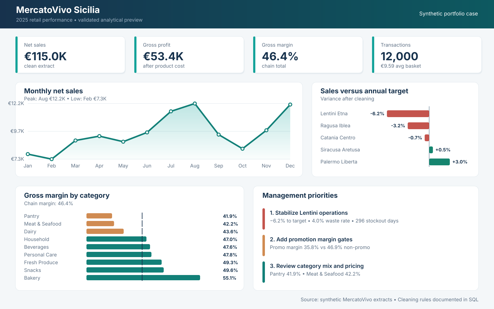

# MercatoVivo Sicilia — Retail Analytics Case Study

A portfolio project that turns eight imperfect retail extracts into a traceable analytical layer and a management recommendation for a fictional five-store supermarket chain in Sicily.

**Status:** validated analysis and static dashboard complete  
**Reporting period:** 1 January–31 December 2025  
**Data:** synthetic, reproducible, and intentionally imperfect  
**Tools demonstrated:** Excel, PostgreSQL, data modelling, KPI design, and dashboard storytelling

> **Business question:** Where should MercatoVivo act first to recover gross margin without damaging sales or product availability?



The image above is a static dashboard preview generated from validated output tables. The Power BI model and page specification are included, but a `.pbix` file is not claimed or included.

## Executive answer

Management should prioritize MercatoVivo Lentini Etna, add margin gates to promotions, and review pricing and product mix in Pantry and Meat & Seafood.

| Finding | Evidence | Management implication |
|---|---:|---|
| Lentini has the clearest combined risk | 6.22% below annual sales target, 45.65% margin, 4.03% waste rate, 296 stockout days | Fix replenishment and availability before applying broad inventory cuts |
| Promotion margin is materially lower | 35.76% promo margin vs 46.86% non-promo margin | Require margin thresholds and post-campaign evaluation |
| Margin pressure is concentrated | Pantry margin 41.86%; Meat & Seafood 42.16%; chain 46.39% | Review price, cost, pack, and assortment decisions by category |
| Private Label has a stronger margin mix | 49.30% margin vs 44.38% for National brands | Test selective Private Label visibility without assuming automatic substitution |

Promotion comparisons are descriptive. They do not prove causal uplift.

## Headline KPIs

| KPI | Validated result |
|---|---:|
| Net sales | €115,031.05 |
| Gross profit | €53,360.74 |
| Gross margin | 46.39% |
| Transactions | 12,000 |
| Net units | 46,318 |
| Average basket value | €9.59 |

All monetary figures refer to the supplied teaching extract, not total company turnover.

## Analysis workflow


Raw data remain unchanged. Duplicate events are removed in views, format-only key problems are standardized, and unsupported rows are quarantined rather than guessed.

## Data-quality results

| Issue | Confirmed result | Treatment |
|---|---:|---|
| Duplicate customer IDs | 2 IDs / 2 excess rows | Keep one identical record |
| Duplicate transaction IDs | 2 IDs / 2 excess rows | Keep one identical basket |
| Duplicate item IDs | 12 IDs / 12 excess rows | Keep one identical line |
| Lowercase store keys | 5 rows | Standardize with `UPPER(TRIM())` |
| Blank product keys | 4 rows | Quarantine |
| Zero quantities | 4 rows | Quarantine |
| Discounts outside 0–1 | 3 rows | Quarantine |
| Inventory reconciliation failures | 0 rows | Accept reconciled inventory |

The full evidence and business-rule interpretation are in [Data quality findings](docs/audit_findings.md).

## Deliverables

- [Executive recommendation memo](docs/executive_summary.md)
- [Data quality findings](docs/audit_findings.md)
- [Consulting project brief](docs/project_brief.md)
- [Data dictionary](docs/data_dictionary.md)
- [Analytical data model](docs/data_model.md)
- [Power BI build specification](powerbi/README.md)
- [Interview walkthrough](docs/interview_walkthrough.md)
- [Completed SQL audit checks](sql/01_data_quality_checks.sql)
- [Traceable clean views](sql/03_clean_views.sql)
- [Business analysis queries](sql/04_business_analysis.sql)
- [Validated result tables](output/README.md)

## Dataset

| File | Grain | Raw rows |
|---|---|---:|
| `stores.csv` | Store | 5 |
| `products.csv` | Product | 40 |
| `customers.csv` | Loyalty customer record | 902 |
| `promotions.csv` | Campaign | 14 |
| `transactions.csv` | Basket | 12,002 |
| `transaction_items.csv` | Basket line | 37,270 |
| `inventory_weekly.csv` | Store × product × week | 10,600 |
| `monthly_targets.csv` | Store × month | 60 |

The clean analytical population contains 12,000 transactions, 37,247 valid transaction lines, and 900 distinct loyalty customers. Anonymous baskets remain valid.

## Reproduce the analytical outputs

Node.js is sufficient; the validation scripts use only built-in modules.

```bash
npm run analyze
npm run dashboard
```

The first command rebuilds the JSON and CSV outputs from `data/raw/`. The second command rebuilds the SVG dashboard from those validated results.

## Repository structure

```text
mercatovivo-retail-analytics/
├── assets/                  # Workbook previews and portfolio dashboard
├── data/raw/                # Immutable synthetic source extracts
├── docs/                    # Brief, audit evidence, model, memo, interview guide
├── output/                  # Reproducible KPI result tables
├── powerbi/                 # Semantic-model and dashboard specification
├── scripts/                 # Dataset, analysis, and dashboard builders
├── sql/                     # Raw schema, audit checks, clean views, analysis
├── workbook/                # Excel audit workbook
├── AI_USAGE.md              # Transparent AI-use disclosure
└── README.md
```

## Limitations

- The project uses synthetic data and a teaching-sized transaction extract.
- Promotion performance is observational rather than causal.
- Missing product IDs are excluded from product analysis because the correct key cannot be inferred safely.
- The dashboard preview is not a substitute for a published Power BI `.pbix` report.

## Author

Portfolio project by [Ghalia Esraidi](https://github.com/ghaliaesraidi).

