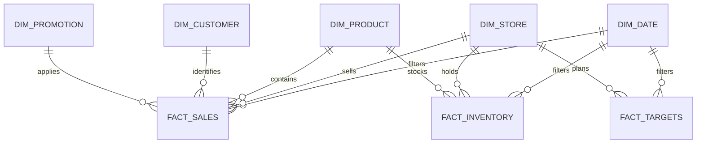

# Data Model

## Recommended analytical model

Use a star schema with two fact tables. Transactions and transaction items have different grains; the analytical sales fact should be one cleaned basket line.

## Fact-table grains

| Table | Grain | Main additive measures |
|---|---|---|
| `fact_sales` | One cleaned transaction line | Quantity, net sales, product cost, gross profit |
| `fact_inventory` | One store × product × week | Opening units, deliveries, sold units, waste units, closing units, stockout days |
| `fact_targets` | One store × month | Revenue target, stockout target; percentage targets require careful aggregation |

## Dimensions

| Dimension | Key | Notes |
|---|---|---|
| `dim_date` | `date` | Create a continuous calendar; include year, month, month number, quarter, week |
| `dim_store` | `store_id` | Standardize key case before relating |
| `dim_product` | `product_id` | Standardize category and brand labels |
| `dim_customer` | `customer_id` | Add a deliberate `Anonymous` member for blank transaction customers |
| `dim_promotion` | `promotion_id` | Add a deliberate `No promotion` member for blank item promotions |

## Relationship rules

- Dimensions filter facts in one direction.
- Use one-to-many relationships from dimensions to facts.
- Do not connect fact tables directly to each other.
- Keep the raw basket table for audit/reconciliation, not as a second path to the same sales fact.
- Create a separate month key for targets or relate targets through the date table at month-start grain.
- Verify that total net sales is unchanged after every relationship is created.

